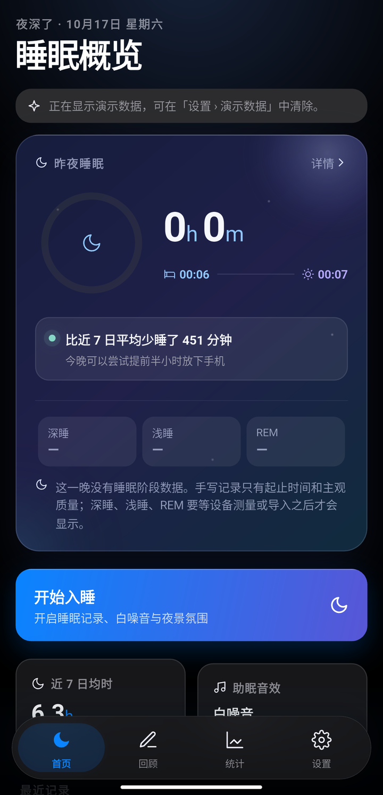
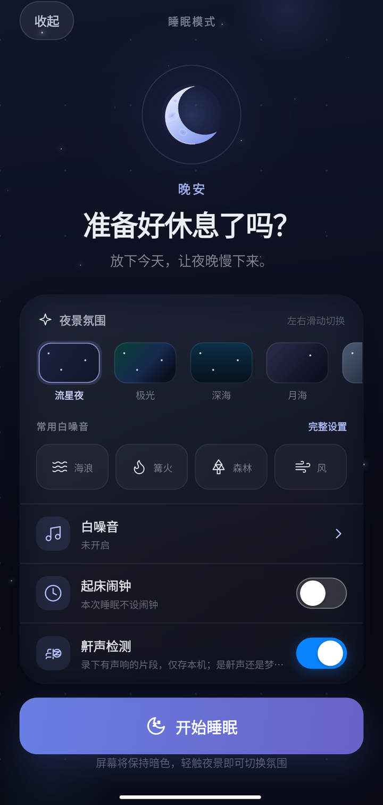
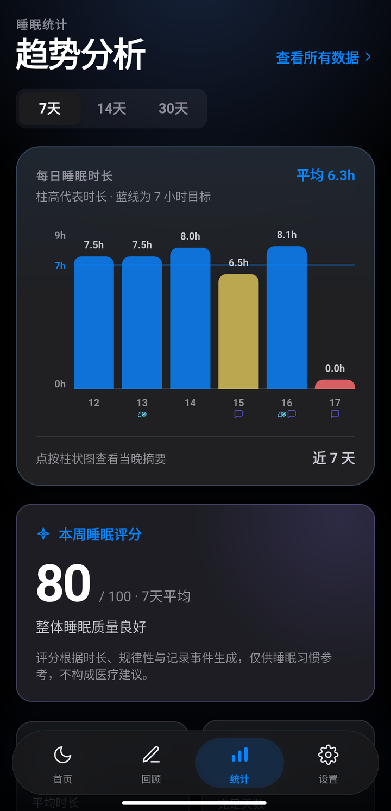
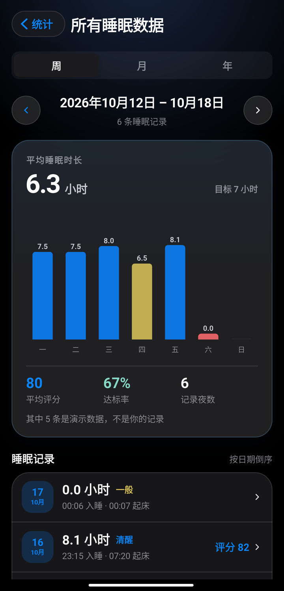
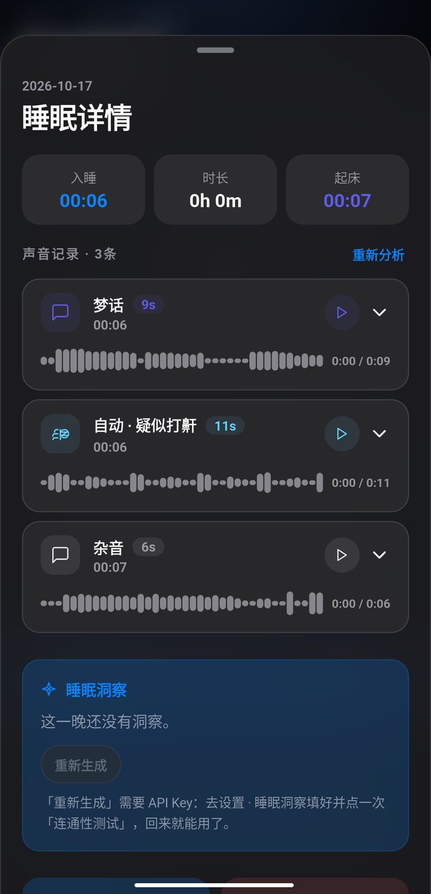
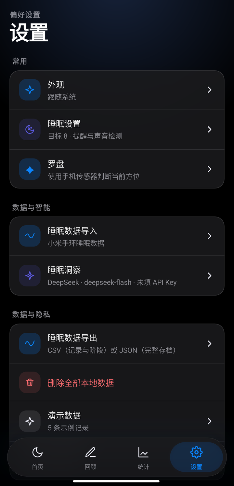

<div align="center">


# 夜深 · night_sleep

**本地优先的睡眠记录应用。数据留在设备上，不上传。**

[](#平台支持)
[](https://flutter.dev)
[](https://dart.dev)
[](#数据与隐私)

界面为中文，按 Figma Make 原型的最终生效层实现：iOS 玻璃材质、悬浮胶囊标签条 / 侧边栏自适应
导航、自绘描边图标集、浅色 / 深色主题。

</div>

---

## 它是什么

用手机记一晚的睡眠：几点睡、几点醒、睡得怎么样，顺便在睡梦中录下有声响的片段，由端侧模型
判断哪些「疑似打鼾 / 疑似人声」——**判定在设备上跑，录音不出机器**。

它**不测量任何东西**。起止时刻来自你按下的按钮，睡眠阶段只有你自己导入或设备给的数据才会显示。
理由见下面的[设计原则](#设计原则)。

## 特性

**记录与统计**

- 睡眠记录、7 / 14 / 30 天统计；**全部记录可按周 / 月 / 年翻阅**，一次看一个周期、左右翻页
- 「回顾」为最近一晚补充主观感受（五档命名状态 + 四类事件 + 备注），可换一晚、可编辑、可删除
- 睡眠评分：本地估算与模型给的分数在界面上分别标成「估算 NN」与「评分 NN」，不混为一谈

**睡前与夜间**

- 睡前会话两态（入睡前 / 睡眠进行中），八种夜景氛围：流星夜 · 极光 · 深海 · 月海 · 云上 ·
  萤火 · 银河 · 雨夜
- 助眠音效 5 条实景录音：海浪 · 篝火 · 森林 · 溪流 · 风，支持音量、定时、切换
- 就寝 / 起床本地通知，以及会话内的一次性起床闹钟
- 长按 1.5 秒结束睡眠（防误触），就地评星

**夜间录音与自动判定**

- 会话期间采集 16 kHz 单声道 PCM，按振幅切出「有声响的片段」，一段一个 WAV
- **端侧 YAMNet 模型**逐窗判定：鼾声按整段均分（另认连续两窗的短事件）、人声按整段均分；
  鼾声 ≥ 0.40、人声 ≥ 0.70，都没过就记「杂音」（数字静音仍留「待标注」）
- **机器只说「疑似」与「杂音」，不给概率**——界面上摆的是测出来的分与判定线，
  让你能直接否掉它
- **人标的永远优先，机器永不覆盖人标的**
- Android 用前台服务保着麦克风，退到后台 / 锁屏继续录；平台静音麦克风时**如实说出来**，
  那颗「录音中」的灯不亮

**数据**

- 导出 CSV（记录 + 阶段两张表）/ JSON 完整存档，**导出前可逐格预览**，经系统分享面板交付
- 助眠音效、自绘图标集、滚轮选择器、罗盘（二十四山 · 后天八卦）
- 可选的睡眠洞察：接任意 OpenAI 兼容服务商，Key 存系统钥匙串

## 平台支持

| 平台 | 状态 |
| --- | --- |
| iOS | ✅ 已构建、模拟器跑通；**真机安装尚未实测** |
| macOS | ✅ 已构建、跑通 |
| Android | ✅ 已构建、真机跑通（MI 9 / API 30），有前台服务 |
| Web | ⚠️ 只有骨架，**从未构建** |

## 截图

> 取自 Android 真机（MI 9，1080×2340），已开启演示数据。

<table>
  <tr>
    <td align="center"><br><sub><b>首页</b> · 昨夜睡眠与结论条</sub></td>
    <td align="center"><br><sub><b>睡前会话</b> · 夜景氛围与就寝设置</sub></td>
    <td align="center"><br><sub><b>统计</b> · 7 / 14 / 30 天趋势</sub></td>
  </tr>
  <tr>
    <td align="center"><br><sub><b>所有睡眠数据</b> · 按周 / 月 / 年翻阅</sub></td>
    <td align="center"><br><sub><b>睡眠详情</b> · 声音记录与端侧判定</sub></td>
    <td align="center"><br><sub><b>设置</b> · 三段导航</sub></td>
  </tr>
</table>

其中「睡眠详情」那张里的 **自动 · 疑似打鼾** 就是端侧模型给的判定，下面那条波形来自真实录音。

想自己重抓：跑一遍界面巡检，宿主机边跑边截——巡检每屏停留约 5 秒，覆盖首页、回顾、统计、设置与
五个二级页、睡眠详情、助眠音效面板、会话页两态。桌面平台也能跑（`-d macos`，不必开模拟器）。

```bash
# 模拟器：一边跑巡检，一边在外面循环截屏
DEV=$(xcrun simctl list devices available | grep -m1 -o '[0-9A-F-]\{36\}')
( for i in $(seq -w 1 70); do
    xcrun simctl io $DEV screenshot /tmp/tour/$i.png; sleep 1.3
  done ) &

export NO_PROXY=127.0.0.1,localhost
flutter test integration_test/app_screens_test.dart -d $DEV
```

Android 真机上把循环换成 `adb exec-out screencap -p > /tmp/tour/$i.png` 即可
（**必须用 `exec-out`**，`adb shell cat` 会把二进制拉坏）。巡检自己**不截图**，图落在哪里由外面
的循环决定；仓里的 `screenshots/` 是给这批核对观感的产物准备的、已 gitignore——README 这几张
是挑过之后单独放进 `docs/images/` 的。

## 快速开始

### 环境要求

- **Flutter stable**，本仓基线 `3.47.5`（Dart `3.13.4`）
- **iOS / macOS**：需要 Xcode。**当前不需要 CocoaPods**——Flutter 3.47 改用 Swift Package
  Manager 解析插件依赖
- **Android**：需要 Android SDK 与 **JDK 17**（`flutter_local_notifications` 要求 Java 17）。
  Android Studio 不是必需的，有 SDK + JDK 就能 `flutter build apk`

### 运行

```bash
git clone https://github.com/abner-forever/night_sleep.git
cd night_sleep
flutter pub get
dart run build_runner build     # 必须；见下
flutter run -d macos            # 或 -d chrome / -d <设备>
```

> ⚠️ **新检出一定要先跑 `build_runner`。** `lib/core/database/app_database.g.dart` 由 Drift 生成、
> 且已 gitignore，缺了它 `flutter analyze` / `flutter test` 会报几百条
> `Undefined name 'ActiveSessionsCompanion'` 之类的错。改表结构后同理。

**演示数据**默认只在 debug / profile 构建里安装，可以强制开关：

```bash
flutter run   -d macos --dart-define=DEMO_DATA=true     # 强制开启
flutter build macos    --dart-define=DEMO_DATA=false    # 发布构建强制关闭
```

### 构建

```bash
flutter build macos --debug
flutter build ios --simulator --no-codesign
flutter build apk --debug
```

国内网络下 `pub get` / Gradle 拉包可能需要镜像。**这些绕过办法一行都不要进仓库**——不要改仓库里的
`distributionUrl`、不要写 `~/.gradle/init.d/`、不要往 shell profile 写环境变量，用命令行前置的
临时变量即可：

```bash
export PUB_HOSTED_URL=https://pub.flutter-io.cn
export FLUTTER_STORAGE_BASE_URL=https://storage.flutter-io.cn
```

> ⚠️ `PUB_HOSTED_URL` 会把 `pubspec.lock` 里上百条 `url: "https://pub.dev"` 一并改写成镜像地址，
> 制造一个与依赖本身无关的巨型 diff。**只在这个 shell 里临时设，依赖齐了就直接 `flutter pub get`。**

## 项目结构

```text
lib/
  app/          路由外壳与跨 feature 的编排：router、标签壳、toast、
                夜间录音控制器、白噪音会话控制器、提醒重排、通知权限闸口
  core/
    config/     构建开关
    database/   Drift schema 与迁移
    platform/   触觉反馈、提醒与闹钟调度、系统栏、前台服务、钥匙串
    theme/      设计令牌（颜色 / 圆角 / 动效曲线唯一的来源）
    widgets/    玻璃材质、iOS 控件、弹层、二级页外壳、滚轮、图标
  features/
    home/ log/ session/ stats/ settings/ onboarding/ compass/
    sleep/{domain,data,presentation}   记录聚合、阶段、评分、分组翻阅、录音与音频管线
test/           领域计算与页面测试（约 840 条用例）
integration_test/  截图巡检与平台路径验证（裸跑 `flutter test` 扫不到，要指名文件 + 设备）
tool/           图标与音效生成器、片段复核脚本
assets/         助眠音效、YAMNet 模型、品牌图标
```

## 技术选型

| 关注点 | 选择 |
| --- | --- |
| 状态管理 | `flutter_riverpod` |
| 路由 | `go_router`（只有一条根路由，其余全是它的子路由，push 盖住整个外壳） |
| 数据库 | `drift` + `sqlite3_flutter_libs`，**schema v8**，6 张表 |
| 音频 | `just_audio`（播放）/ `record`（采集） |
| 通知 | `flutter_local_notifications` + `timezone` |
| 密钥 | `flutter_secure_storage`（系统钥匙串） |
| 端侧推理 | `tflite_flutter` + YAMNet（AudioSet 521 类） |

**架构约定**：`features/<feature>/{presentation,domain,data}`，三个层次按需出现。
**Widget 不直接碰数据库**——`SleepRepository` 用批量查询组装聚合，UI 的唯一数据源是
`sleepEntriesProvider`。设计令牌只有一份，不要在 widget 里写死色值。

**片段分析分三层，边界不能搅**：判定规则（纯函数，能被完整单测，**不许 import `tflite_flutter`**）
/ 跑模型 / 读文件 + isolate + 写库。模型字节必须在主 isolate 读——后台 isolate 收不到平台消息。

## 测试

```bash
dart format .
flutter analyze
flutter test                     # 整套
flutter test test/sleep_score_test.dart                       # 单个文件
flutter test test/sleep_score_test.dart --plain-name "时长阶梯"  # 单个用例（子串匹配）
```

`integration_test/` **不在裸跑 `flutter test` 的扫描范围里**（它只扫 `test/`），要**指名文件 +
指定设备**：

```bash
export NO_PROXY=127.0.0.1,localhost     # 不设会表现为「连不上 VM Service」
flutter test integration_test/noise_playback_test.dart -d macos
```

## 数据与隐私

- **数据留在设备上**：SQLite 在应用目录，录音在 `getApplicationSupportDirectory()/clips/`，
  默认只保留最近 7 晚，超期删文件、**行保留**
- **应用会联网，且全部由用户点击触发**，共 4 处：获取可用模型、连通性测试、查询余额、生成洞察。
  全部只发结构化睡眠字段，**用户自由文本备注不发送**；API Key 只进请求头，**不落日志、不落盘**
- **导出是把文件交给系统分享面板，去向由你选择**，应用自己不发起传输
- 权限只在用到时申请：通知权限仅在你打开提醒开关时申请，麦克风权限仅在打开夜间录音时申请

## 设计原则

**「没有的东西就显示为没有」。** 这是这个项目的产品红线，不是待办列表：

- **不伪造睡眠阶段**——阶段只在该记录确有阶段数据时出现
- **没有测量就不画**——没有真实音频就不画波形；模型按整段给结论，就绝不画事件区间
- **不显示读不到的余额**，**不猜导入数据的字段**
- **机器只对「有声音、但没测到鼾声/人声」的片段标「杂音」**：它说的是「机器没找到够格的
  证据」，不是「已证明这不是鼾声」；数字静音、读不出来、从没分析过仍然留「待标注」
- **只说「疑似」、不给概率**——依据行摆的是测出来的分与判定线，让人能直接否掉它
- **人标的永远优先，机器永不覆盖人标的**

## 已知限制

这一节写的是「还差什么」，**不要当成已完成**。

| 项 | 现状 |
| --- | --- |
| **鼾声判定的准确率** | **换引擎之后一个数都没量到**。旧规则在一批 47 段人工标注上是覆盖 2% / 准确 0%，换 YAMNet 后**还没在同一批上量过**（那批录音随卸载丢失）。两条明写在案：**人声阈值 0.70 这一档根本没量过**；**均分有盲区**——11.8 秒里只有 3.5 秒是鼾声会被摊薄成弃权 |
| **iOS / macOS 上的端侧推理** | **一个字节都没跑过**（macOS 的 `.dylib` 不随 podspec 安装） |
| **白噪音后台播放** | 收起页面后继续响，但**退到后台或锁屏会停**，界面已如实标注 |
| **小米手环导入** | 导入按钮**仍禁用**。可行性已实测到连接层，但**没有任何一条路径被跑通到「拿到数据」** |
| **Android 发布就绪度** | `applicationId` 仍是占位 `com.example.night_sleep`；release 构建用 debug 签名；加了前台服务后上架需要单独提交用途申报 |
| **界面观感** | 会话页下拉的手感、整夜动画的绘制开销等只有自动测试钉住几何与结构，**「好不好看」没在真机核过** |

### 授权（发布阻塞项）

- **助眠音效素材**：5 条录音来自爱给网（aigei.com），**可商用授权尚未落实**，发布前必须确认、
  更换或退回合成
- **判定模型文件**：`assets/model/yamnet.tflite` 是 MediaPipe 发布的**转换件**。模型文件内嵌元数据
  与上游 YAMNet 权重都是 Apache-2.0，但 MediaPipe 的文档**没有正面声明**这一条

## 常见问题

**Android 构建挂住、不报错、日志不动？** 先加 `--offline` 跑一次——它会把「挂住」立刻变成
「明确告诉你缺哪个包」。最常见的原因是漏了
`FLUTTER_STORAGE_BASE_URL=https://storage.flutter-io.cn`：引擎的 ABI jar 不在任何 Gradle 镜像
改写范围内，缺了它 `:app:compileDebugKotlin` 会静默挂十几分钟，极易误判成「机器慢」。

**`ZipException: Archive is not a ZIP archive`？** 别去查解压工具，真实原因是下载**被截断**。
判断 SDK 组件「已装好」的可靠依据是 `platforms/android-3X/android.jar`（27 MB 上下）在不在——
失败的安装会留下一个只有 `.installer` 的空目录。

**`Could not close incremental caches … different roots`？** 跨盘造成的（pub 缓存在 `C:`、工程在
`D:`，Kotlin 增量缓存存绝对路径，跨盘建不出公共根）。绕过办法已固化进 `android/gradle.properties`，
**单盘机器和 CI 上可以把那两行连同注释一起删掉**。

**不碰 Gradle 配置的约定**：需要绕行时用命令行临时变量或 `-I <临时脚本>`，不要改仓库里的
`distributionUrl`、不要写 `~/.gradle/init.d/`。唯一的例外是上面那条跨盘问题——它每次
`flutter run` 都必然复现，所以固化进了仓库。

## 贡献

- 界面文案、注释、文档**一律中文**；代码标识符英文
- 提交前跑 `dart format .`、`flutter analyze`、`flutter test`
- **先分清改动大小**：能直接从代码推出来的决策（bug、文案、样式、单点开关）直接改就行，
  不必先写方案；跨多处、有硬约束或新能力才需要先写设计与计划
- **不要改 `lib/**/*.g.dart`**（Drift 生成物）；图标与音效是生成物，
  **要改就改 `tool/` 下的生成器再跑一遍，别手改产物**
- 判人类的改动**要用数字收账**（覆盖率 + 准确率一起报），样本不足时不要调参

## 许可证

**本仓库当前没有 LICENSE 文件**，即版权默认保留。在补上之前，请勿视为可自由使用。

需要一并解决的两项第三方授权（见[授权](#授权发布阻塞项)）：助眠音效素材的可商用授权、
以及 `assets/model/yamnet.tflite` 转换件的许可证声明。
